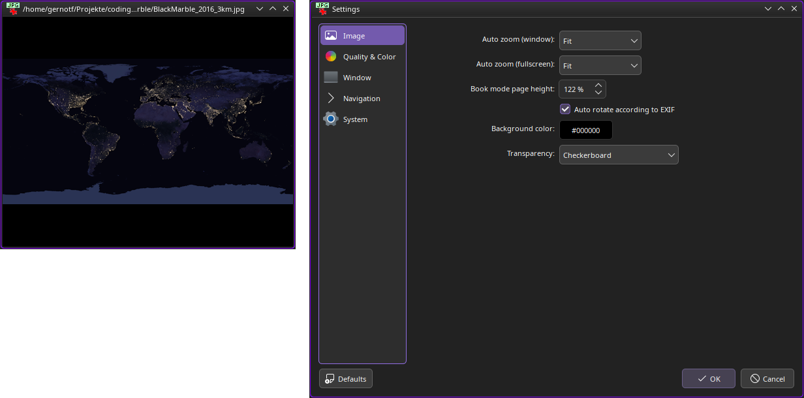

# mkImageViewer

A minimalist, fast Qt6 image viewer for Linux, controlled mainly by keyboard and mouse shortcuts.
It also reads comic archives (CBZ/CB7) and serves as the reader for
[mkMangaBrowser](https://github.com/KrokusPokus/mkMangaBrowser).

mkImageViewer is a Linux port of [JPEGView_L](https://github.com/KrokusPokus/JPEGView_L), which in turn is based on
[JPEGView](https://github.com/sylikc/jpegview), originally written by David Kleiner.



## Features

- **Formats:** JPEG, PNG/APNG, WebP, AVIF, HEIF/HEIC, JPEG XL, QOI, GIF, BMP, TGA, TIFF, PSD/PSB, ICO
- **Comic archives:** CBZ and CB7 are browsed like a folder
- **Animations:** animated GIF, APNG, WebP and JPEG XL; a whole folder can also be played as an animation
- **High-quality resampling** in linear light, colour management with embedded ICC profiles (Little CMS)
- **Navigation:** within the folder, recursively, or across sibling folders; sorting by name, date, size or random
- **Zoom modes:** fit, fill with crop, never upsize, fixed zoom, and a book mode for reading (single pages at a
  chosen height, double pages at window width)
- **Slideshow** with transition effects
- **File operations:** rename, move to trash, delete, copy image or path to the clipboard, open in the default editor
- Auto contrast, black-and-white mode, info overlay
- **Freely configurable keyboard and mouse bindings**
- English and German user interface

## Configuration

| File | Contents |
|------|----------|
| `~/.config/mkProjects/mkImageViewer.conf` | Settings (also editable in the settings dialog) |
| `~/.config/mkProjects/mkImageViewer_keymap.conf` | Key and mouse bindings |
| `~/.local/state/mkProjects/mkImageViewer_state.conf` | Window geometry and other state |

The key map is written with the built-in defaults on first start and lists all available commands at the end.
It replaces the defaults completely; delete it to get the defaults back.

## Requirements

- 64-bit Linux
- Qt ≥ 6.5 (Core, Widgets, Concurrent, DBus, Network, LinguistTools, GuiPrivate), CMake ≥ 3.16, a C++20 compiler
- System libraries: libavif, libheif, libjxl, Little CMS 2, zlib
- libjpeg-turbo, libpng, libwebp and bit7z are included as static libraries in `src/`
  (build scripts for them are in `extras/scripts/`)
- Optional at runtime: 7-Zip (CB7/7z archives), `kimageformats` and `qt6-imageformats` (more formats through Qt)

On Arch Linux:

```bash
sudo pacman -S --needed base-devel cmake qt6-base qt6-svg qt6-tools libavif libheif libjxl lcms2
sudo pacman -S --needed 7zip kimageformats qt6-imageformats   # optional
```

## Building and installing

```bash
git clone https://github.com/KrokusPokus/mkImageViewer.git
cd mkImageViewer
cmake -B build -DCMAKE_BUILD_TYPE=Release -DCMAKE_INSTALL_PREFIX=/usr
cmake --build build --parallel
sudo cmake --install build                   # installs system-wide
sudo xargs rm < build/install_manifest.txt   # uninstalls again
```

For development, `./build.sh` builds into `build/` without installing, and `./build_lupdate.sh` updates the
translation sources in `i18n/*.ts`.

> **Note:** release builds use `-march=native`. The binary is optimized for the CPU it was built on and may not run
> on older CPUs. Build on the target machine, or remove the flag from `CMakeLists.txt` for a portable binary.

The installed `.desktop` file registers mkImageViewer for all supported image and comic formats. To make it the
default viewer, choose it in the file manager's *Open With* dialog with *Remember application association*, or under
*System Settings → File Associations*.

## Credits

- David Kleiner, author of the original JPEGView
- Kevin M (sylikc) and the contributors of the JPEGView fork
- aviscaerulea for the optimized alpha blending code
- sdneon for the archive reading code

## License

GPL-2.0-or-later, see [LICENSE.txt](LICENSE.txt) and [COPYING.txt](COPYING.txt).
Third-party libraries keep their own licenses, see [extras/third_party/README.md](extras/third_party/README.md).
